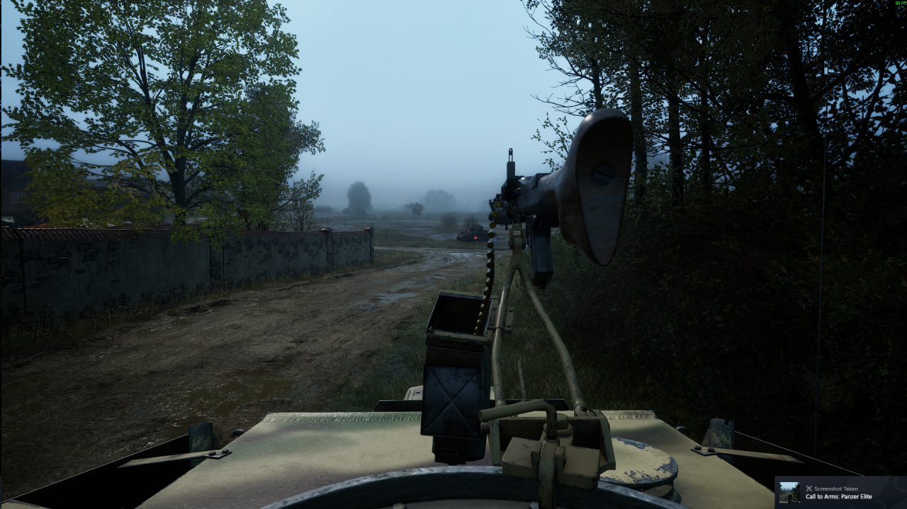

# CtACmdr - commander view for Call to Arms: Panzer Elite

*Looking out over the hull roof from the commander's position. Hatch rim,
MG mount and ammo box in frame. This is the view the mod gives you.*

A mod that gives you a proper tank commander view.

The game ships with an external camera that slides into the gunsight.
There is no commander position to switch to. This mod puts the camera
at the commander's head instead, lets you move it, and remembers the
position for each tank.

## What you get

- Commander view: head up, out of the cupola.
- Free look, fairly wide limits.
- Your own camera position, nudged with the numpad.
- One saved position per tank, remembered across sessions.
- **The binoculars still work.** They use their own camera, so raising
  them from the commander view behaves normally.

## Keys

| Key | Does |
| --- | --- |
| F3 | Commander view on / off |
| F4 | Back to the normal view |
| NUM 8 / 2 | Camera forward / back |
| NUM 4 / 6 | Left / right |
| NUM 9 / 3 | Up / down |
| NUM 5 | Reset the offset to zero |
| NUM 0 | Save this tank's position |
| F6 | Write a report to CtACmdr.log |

Each numpad press moves the camera 5 cm. Hold or tap to creep.

The view also applies itself about 1.5 seconds after you get into a
vehicle that has a saved position.

## Install

**Full walkthrough, including installing UE4SS from scratch:**
**[INSTALL.md](INSTALL.md)**

The short version, if you already have UE4SS:

    powershell -ExecutionPolicy Bypass -File tools\install.ps1

Or by hand:

1. Copy the `CtACmdr` folder into
   `Call To Arms - Panzer Elite\call_to_arms_pe\Binaries\Win64\Mods\`
2. Add this line to `Mods\mods.txt`:

       CtACmdr : 1

The game needs UE4SS installed. This install already has it.

## Uninstall

Delete `Mods\CtACmdr` and the `CtACmdr : 1` line in `mods.txt`.

Nothing is written into the game's .pak files. Nothing touches your saves.

## Where the positions live

    Binaries\Win64\CtACmdr_views.txt

One line per tank, in the form:

    BP_PzKpfwIVAusfG_C -70.00 0.00 0.00

The name is the vehicle blueprint class, then X, Y, Z in centimetres.

## Singleplayer only

There is no anti-cheat in this game, but keep it out of multiplayer.

## See also

- `docs/api-notes.md` - everything found out about the game's internals
- `docs/game-enums.txt` - 67 game enums dumped from the running game
- `NOTES.md` - the working diary, including the dead ends

---

## Credits

**Created by DeepSeek, at the behest of a human.**

Every part of this was produced by DeepSeek in a single working session,
at the request of [@murkzuk](https://github.com/murkzuk):

- the reverse-engineering of the game's camera, crew and hatch systems
- the reflection probes, and the crash forensics that pinned down which
  reflection calls this build cannot survive
- the Lua mod
- the per-tank camera save system
- this documentation

The human drove: it was their idea to build a commander view, they sat
through every crash test, and they decided when a view was good enough.

---

## License

MIT - see [LICENSE](LICENSE).

Use it, change it, ship it, fork it. Just keep the copyright notice, and
do not hold anyone liable if it breaks something.
